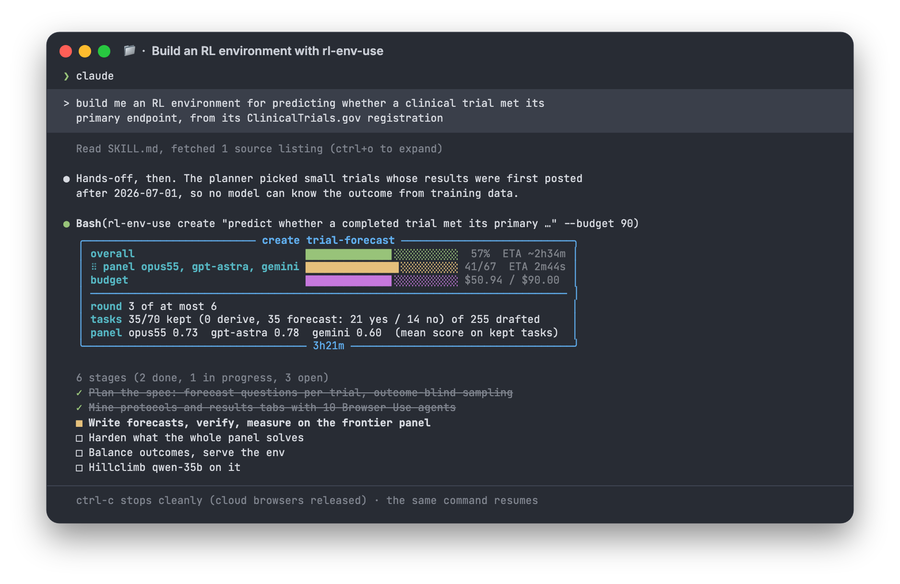
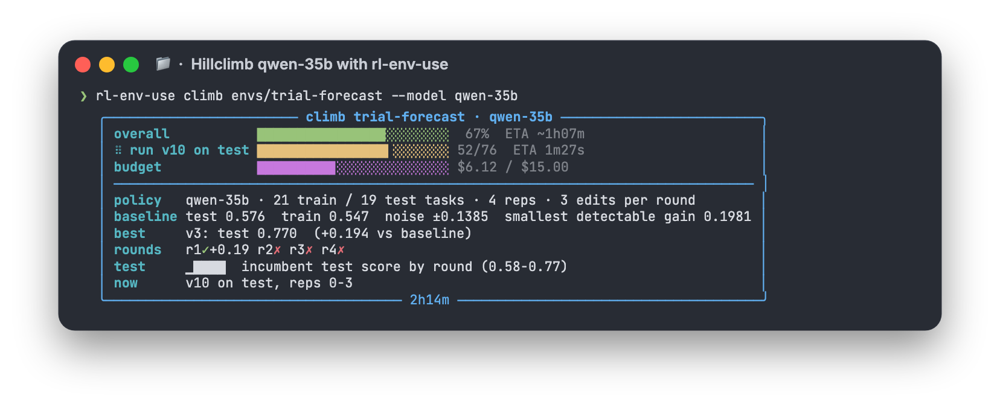

<p align="center">
  
</p>

# rl-env-use

Introducing **rl-env-use** — RL environments for any domain, built by browser agents from real cases. 100% open source.

Describe a skill in one line, get back a verified environment that frontier models do not saturate, and a hillclimbed
prompt for the model you want to train. Works for any domain where inputs and outcomes live on the web — filings,
registries, trial records, court dockets, contest archives — without hand-written tasks or human graders.

Get a Browser Use API key at [Browser Use Cloud](https://cloud.browser-use.com/?utm_campaign=rl-env-use&utm_source=github).

## What it does

- **Mines real cases** with parallel Browser Use agents: the materials a model gets (a protocol, a 10-Q) and the true
  outcome published later or elsewhere (the posted results, the next filing), every fact quote-verified on its page
- **Writes hard tasks by design**: derived numbers are computed by code from operands in the materials, forecasts are
  scored with Brier, and anything a three-lab frontier panel (Opus 5.5, GPT-6 Astra, Gemini) solves goes back to be
  rewritten harder
- **Rejects what does not measure the skill**: answers leaked into the prompt, outcomes the panel knows from memory,
  forecasts the materials do not move, ambiguous or multi-value prompts, stale evidence
- **Grades programmatically** (number, date, set, exact, probability) with a self-test against null, foreign and
  perturbed golds
- **Hillclimbs a model's system prompt** the way Anthropic's eval-hillclimb guide does it: train/test split by case,
  A/A noise floor, paired case bootstrap, and an edit is kept only on a significant test gain
- **Shows a live board** while it runs: stage bar with ETA, spend against budget, kept tasks, panel scores
- **Exports the dataset** (prompt + context + verifiable answer) for an RL trainer, or serves it in code with `Env`

## Setup prompt

Paste into Claude Code, Codex, Hermes, Openclaw, or any agent with shell access:

```text
Set up https://github.com/browser-use/rl-env-use for me.

Read install.md first to install this repo, register the skill with whichever agent you're running under, and set up the Browser Use and OpenRouter API keys - ask me to paste them when you need them. Then read SKILL.md for daily usage. After install, don't build anything on your own - just tell me it's ready and wait for me to name a skill.
```

Then ask for an environment:

> build me an RL environment for predicting whether a clinical trial met its primary endpoint, from its ClinicalTrials.gov registration

It plans the spec, mines, writes and verifies tasks until the target, the budget, or two dry rounds, then hillclimbs the
model you name. Everything lands in `./envs/<name>/`.

## Two commands

```bash
rl-env-use create "predict whether a completed trial met its primary endpoint from its registered protocol; ClinicalTrials.gov" --budget 40
rl-env-use climb envs/<name> --model qwen-35b
```

<p align="center">
  
</p>

Ctrl-C stops either one cleanly (cloud browsers are released) and the same command resumes it. Compare models with
`rl-env-use run envs/<name> --model opus55 --flow models`, open the data, tasks and traces with `rl-env-use review envs/<name>`.

## Manual install

Python 3.11+, optionally Node.js (>= 18) for the HTML reports.

```bash
git clone https://github.com/browser-use/rl-env-use ~/Developer/rl-env-use
cd ~/Developer/rl-env-use
uv venv && uv pip install -e '.[test]'     # or: python3 -m venv .venv && .venv/bin/pip install -e '.[test]'
cp .env.example .env && $EDITOR .env       # BROWSER_USE_API_KEY=...  OPENROUTER_API_KEY=...
.venv/bin/python -m pytest -q              # offline, ~10 s
ln -sfn ~/Developer/rl-env-use ~/.claude/skills/rl-env-use   # optional: the skill for Claude Code
```

## How it works

The model under test never browses. It **reads** a case and answers, and the grader knows the true outcome. Browsing is
how the environment gets built: the data that makes a case hard to fake (a results table behind a tab, a filing behind
a search form) is what a plain HTTP fetch does not see.

<p align="center">
  
</p>

> Plain fetch (Claude Code with WebSearch + WebFetch), 8 trial-results missions: **0 of 86 facts verified**.
>
> rl-env-use, same missions in cloud browsers: **17 verified facts, 4 complete cases**.

```
plan ──> mine ──> write ──> verify ──> panel ──> harden ──> serve ──> climb
          │                                         │
          └─ browser agents, one record each        └─ too easy? rewrite harder on the same case (max 2 levels)
```

| Stage  | What happens |
|--------|--------------|
| plan   | one line becomes a spec: skill, sources, answer conventions, a case-selection rule that never looks at outcomes |
| mine   | the planner reads the source listing and gives each Browser Use agent its own records; agents save materials and outcome passages, every quote checked on its page |
| write  | tasks per case: derive (code-evaluated expression) or predict (yes/no, Brier-scored), outcomes balanced 60/40 at most |
| verify | structure, leakage, closed-book memory check, live evidence, an independent critic |
| panel  | three frontier labs answer with the materials (and forecasts also without): all-solved tasks are hardened, memorized or unmoved forecasts dropped |
| climb  | K prompt edits per round screened on train, kept only on a paired bootstrap test gain, final check on fresh reps |

## Results

Measured on the shipped environments ([`envs/stats.json`](envs/stats.json)). Small samples: read them as demonstrations.

**trial-forecast** — 35 forecasts from 29 ClinicalTrials.gov trials (21 yes / 14 no), built for $72 ($17 of it
Browser Use). Score is 1 - Brier; always answering 50% scores 0.75.

| model | score |
|-------|-------|
| GPT-6 Astra | 0.82 |
| Claude Opus 5.5 | 0.76 |
| Qwen 3.8 27B | 0.75 |
| Gemini 3.1 Pro | 0.60 |
| Qwen 3.6 35B-A3B | 0.60 |

`climb` on Qwen 3.6 35B-A3B kept one of 12 edits (base-rate priors per question type): **0.53 -> 0.78 on fresh test
reps**, paired +0.25 [+0.07, +0.45], for $8.19. Most of that gain is calibration — the model stopped giving extreme
probabilities — not better reading of protocols.

**sec-credit** — 178 verified tasks from 26 small-cap SEC filers. The whole frontier panel solved 153 of 156 derive
tasks from a 10-Q excerpt, so its headroom is in forecasts: 18 tasks are kept as frontier-hard.

**Why browsers** — the same mining missions run by vanilla Claude Code (WebSearch + WebFetch) and by Browser Use agents,
counting facts whose quote is found verbatim on the cited page:

| missions | Claude Code | Browser Use |
|----------|-------------|-------------|
| 8 x clinical trial results | 0 of 86 returned facts verified | 17 verified, 4 complete cases |
| 6 x clinical trial results, same model both sides | 0 of 43 | 3 verified, 2 complete cases |
| 8 x human genetic variants (UniProt, gnomAD, GTEx) | 6 of 82, $11 | 40 verified, $10 |

All 35 trial-forecast tasks and 13 of the 18 sec-credit tasks rest on data a plain HTTP fetch of the page does not show.

## Design principles

1. **Real outcomes, not synthesized ones.** A case is materials plus what actually happened later.
2. **Correct by construction.** Code computes derived golds; the drafting model never does.
3. **Hard is measured, not claimed.** A frontier panel from three labs decides what is too easy.
4. **Outcome-blind selection.** Cases are picked before anyone sees the result; forecasts are balanced.
5. **A gain counts only on test.** Every climb result comes with its noise floor and confidence interval —
   "within noise - do not merge" is a result.

See [`SKILL.md`](./SKILL.md) for the full workflow, the step-by-step mode with sign-offs, and where every file is saved.
