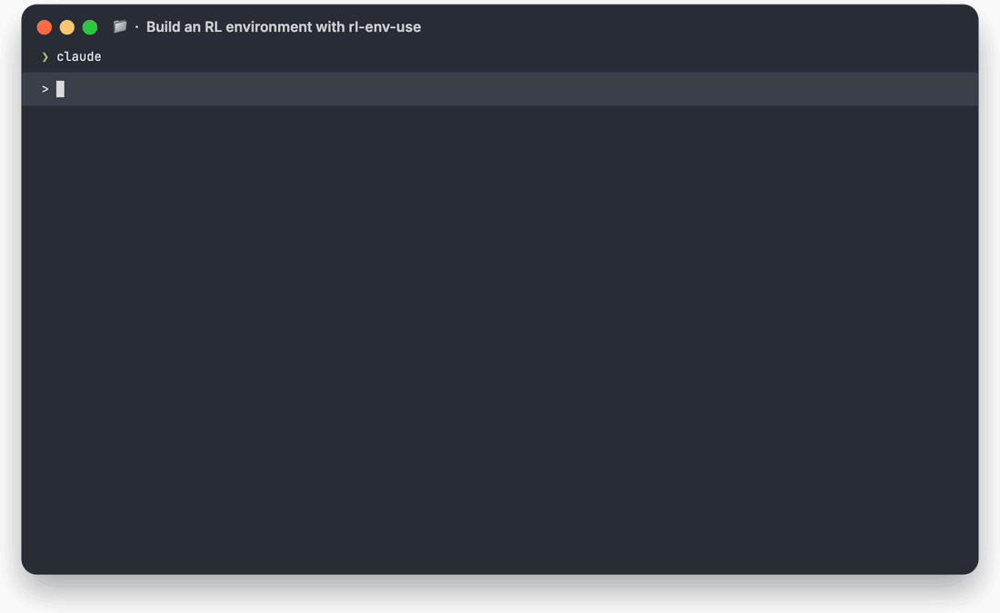
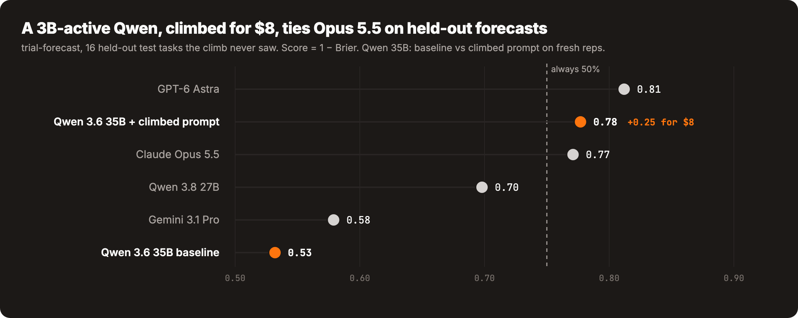
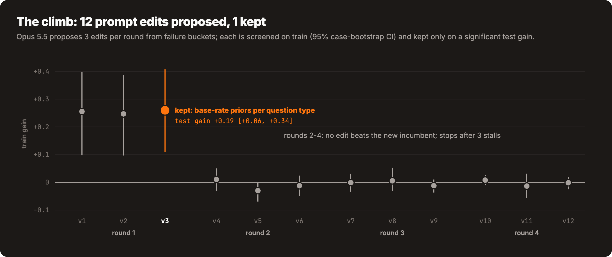
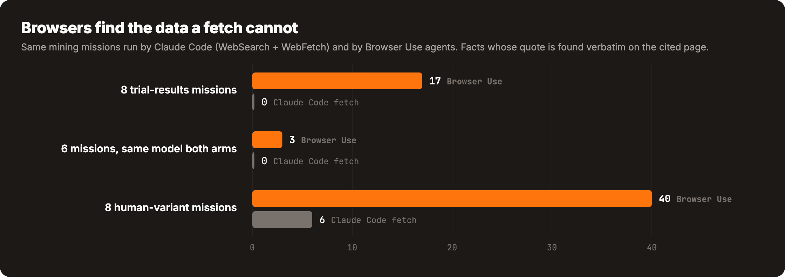
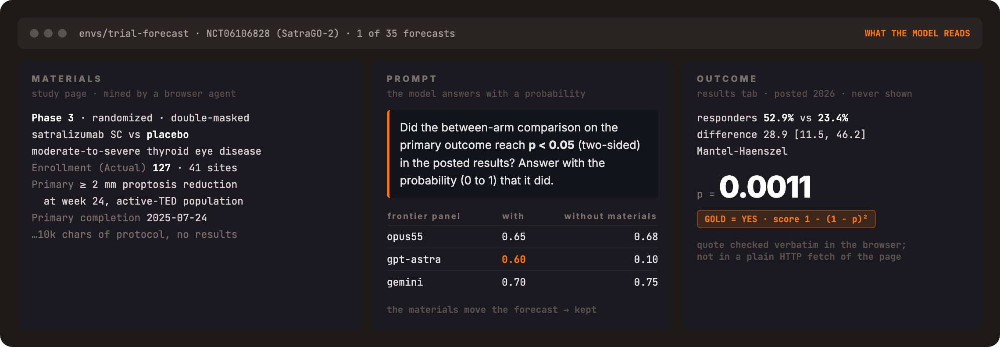

<p align="center">
  
</p>

# rl-env-use

Introducing **rl-env-use**: RL environments for any domain, built by browser agents from real cases. 100% open source.

Describe a skill in one line. Get a verified environment that frontier models do not saturate, and a hillclimbed prompt
for the model you train. It runs Anthropic's [Automating eval design and hillclimbing](https://claude.dev/blog/automating-eval-design-and-hillclimbing/)
workflow end to end, with one change: the tasks are real cases that [Browser Use](https://browser-use.com) agents mine
from the web, not synthesized ones.

Get a Browser Use API key at [Browser Use Cloud](https://cloud.browser-use.com/?utm_campaign=rl-env-use&utm_source=github).

## What it does

- **Mines real cases**: the materials a model gets (a trial protocol, a 10-Q) and the outcome published later
- **Writes hard tasks**: gold answers computed by code, forecasts scored by Brier, anything a frontier panel solves gets rewritten harder
- **Rejects bad tasks**: leaked answers, memorized outcomes, ambiguous prompts
- **Hillclimbs** a model's system prompt with a train/test split, a noise floor and paired confidence intervals
- **Exports** the dataset for an RL trainer, or serves it in code with `Env`

## Setup prompt

Paste into Claude Code, Codex, or any agent with shell access:

```text
Set up https://github.com/browser-use/rl-env-use for me.

Read install.md first to install this repo, register the skill, and set up the Browser Use and OpenRouter API keys - ask me to paste them when you need them. Then read SKILL.md for daily usage. After install, don't build anything on your own - just tell me it's ready and wait for me to name a skill.
```

Then ask:

> build me an RL environment for predicting whether a clinical trial met its primary endpoint, from its ClinicalTrials.gov registration

Or run the two commands yourself:

```bash
rl-env-use create "predict whether a completed trial met its primary endpoint from its registered protocol; ClinicalTrials.gov" --budget 40
rl-env-use climb envs/<name> --model qwen-35b
```

## Results

The shipped example, [`envs/trial-forecast`](envs/trial-forecast): 35 forecasts from 29 ClinicalTrials.gov trials whose
results were posted since July 2026, after the models' training data. Built for $72, $17 of it Browser Use.

<p align="center"></p>

A climbed Qwen 3.6 35B-A3B goes from 0.53 to 0.78 on tasks it never trained on (+0.25, 95% CI +0.07 to +0.45), level
with Opus 5.5. Always answering 50% scores 0.75, so most of the gain is calibration: the model stopped answering 0 or 1.

<p align="center"></p>

Opus 5.5 proposed 12 edits from failure buckets. One survived the test gate: base-rate priors per question type.
Each round's failure buckets, edits and full prompts are in [`climb-qwen-35b/`](envs/trial-forecast/climb-qwen-35b).

<p align="center"></p>

The results tables sit behind tabs and search forms. All 35 tasks rest on data a plain HTTP fetch does not return.

## How it works

The model under test never browses. It reads a case and answers; the grader knows what happened.

<p align="center"></p>

```
plan ──> mine ──> write ──> verify ──> panel ──> harden ──> climb
          │                                         │
          └─ browser agents, one record each        └─ too easy? rewrite harder (max 2 levels)
```

## Manual install

Python 3.11+, optionally Node.js 18+ for the HTML reports.

```bash
git clone https://github.com/browser-use/rl-env-use ~/Developer/rl-env-use
cd ~/Developer/rl-env-use
uv venv && uv pip install -e '.[test]'
cp .env.example .env && $EDITOR .env    # BROWSER_USE_API_KEY, OPENROUTER_API_KEY
.venv/bin/python -m pytest -q           # offline, ~10 s
```

## Design principles

1. **Real outcomes.** A case is materials plus what actually happened.
2. **Correct by construction.** Code computes derived golds, never the drafting model.
3. **Hard is measured.** A panel from three labs decides what is too easy.
4. **A gain counts only on test.** "Within noise, do not merge" is a result.

See [`SKILL.md`](./SKILL.md) for the full workflow and where every file is saved.
